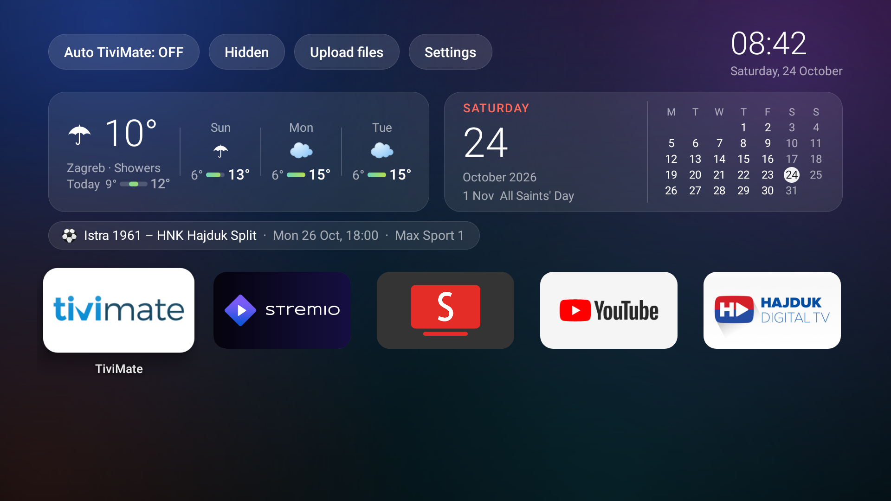

# Xiaomi Box Lite Launcher

A light home screen for Xiaomi Android TV boxes (Mi Box 4/S, Xiaomi TV Box S with Google TV) in
an Apple TV-like "glass" style. Instead of Xiaomi's and Google's recommendations and ads it shows
only what you need:

- **weather** for your place (today and 3 days, Open-Meteo),
- a **month calendar** with today and Croatian public holidays,
- your club's **next match** with the TV channel (FotMob; default HNK Hajduk Split),
- **DHMZ weather warnings** for your county (wind, rain, snow...), only while there are any,
- optionally **events** from Google Calendar and **tasks** from Todoist,
- an app grid (TiviMate, Stremio, SmartTube, YouTube first), hiding apps, starting TiviMate
  automatically after power-on, and **Upload files** (send APKs, videos and
  settings to the box from a browser on your phone or laptop).

The interface is in English by default; `language: hr` in `settings.txt` switches it, the weather
descriptions, DHMZ warnings and holiday names to Croatian.

There is also a script that removes recommendations, ads and Xiaomi analytics from the box
(`cleanup/cleanup.sh`, undone by `cleanup/restore.sh`).

## Setup

### A) With Claude Code (recommended)

You need a laptop (Windows, Mac or Linux) on the same network as the box and
[Claude Code](https://claude.com/claude-code). On the box, turn on USB debugging:

1. Settings → System (or Device Preferences) → About → click **Build** 7 times
   (on Google TV: "Android TV OS build").
2. Settings → System → Developer options → turn on **USB debugging**.
3. Note the box's IP address: Settings → Network & Internet → your network.

Then clone the repository, start Claude Code in it and write, for example:

> Set up this launcher on my Xiaomi box, the IP address is 192.168.1.50.

Claude follows [CLAUDE.md](CLAUDE.md):

1. shows you which box it found and waits for your confirmation,
2. **makes a complete backup** ([backup.sh](backup.sh): settings, app lists, APKs of your apps)
   and helps you save data inside apps such as TiviMate; until the backup is done and checked,
   it changes nothing on the box,
3. goes through the app list with you (what stays, what goes) and cleans up the box,
4. installs the launcher and SmartTube,
5. asks for the language, your place, club, calendar and Todoist, and creates and sends the
   settings files.

On the TV you will once have to confirm "Allow USB debugging".

### B) Manually

The ready-made APK is in [Releases](../../releases). Step by step (backup, installation,
cleanup, SmartTube, sending files) is in [MANUAL.md](MANUAL.md).

## Personal settings

The launcher works without any settings (English, Zagreb and HNK Hajduk Split). For your own, add one or
two small text files to the box. Send them with **Upload files** (open it on the TV, type the
address shown there into your phone's browser and pick the file); with Claude Code, Claude
creates and sends them for you.

| File | What | Example |
|---|---|---|
| `settings.txt` | place, club and language | [settings.example.txt](settings.example.txt) |
| `calendars.txt` | Google Calendar (secret iCal address) and Todoist | [calendars.example.txt](calendars.example.txt) |

`calendars.txt` contains secrets (your calendar address and Todoist token). Never commit it; both
files are in `.gitignore` for that reason.

## Building

No Android Studio needed: `TOOLS=/path/to/tools sh build.sh`. What goes in the tools folder and
where to get it is in [CLAUDE.md](CLAUDE.md#building-the-apk). To just install, the APK from
Releases is enough.
